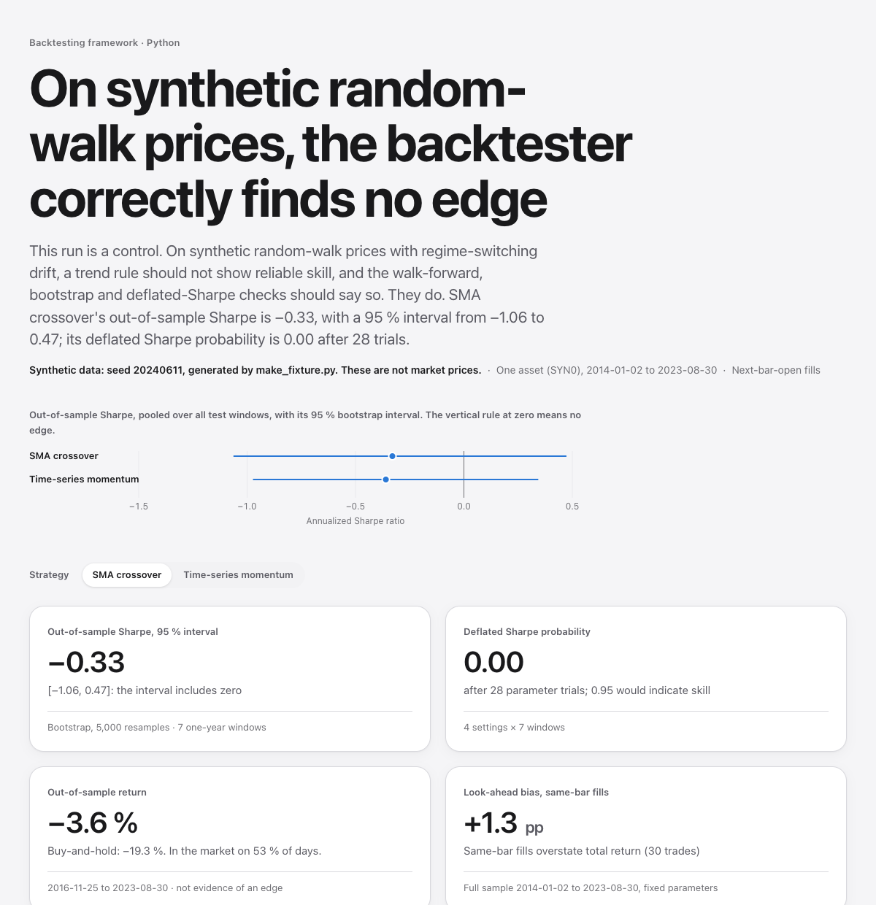

# quantsim

A Python backtester for daily stock prices with two engines that agree: an event-driven one that models orders and fills, and a vectorized one for sweeping many parameter settings. It is built to make two mistakes hard: trading on prices you could not have known yet, and overfitting to the past.

**[Read the report →](https://allenwang0.github.io/quantsim/)** measurements, methodology and limitations, built from the committed results.



## Highlights

<!-- results:start -->
- **Two engines that agree.** A parity test runs one strategy through both and requires equal trade counts and total returns within 0.5 pp.
- **Vectorized engine 460× faster** on 50 assets × 10 years: 0.10 s vs 45.5 s event-driven (median of 5 runs, synthetic data, one strategy, Apple M5 Pro).
- **No lookahead by default.** A signal on one day fills at the next day's open; on the seeded demo, same-bar fills would change the SMA crossover's return by +1.3 pp.
- **Overfitting checks.** Walk-forward testing, bootstrap Sharpe intervals and a deflated Sharpe ratio that discounts for 28 trials. On synthetic data the deflated Sharpe is 0.00: no edge is certified.
- **Default costs:** 0.1% commission + 0.1% slippage per trade in the vectorized engine.
<!-- results:end -->

## Run it

```bash
git clone https://github.com/allenwang0/quantsim.git && cd quantsim
make setup
uv run python tests/fixtures/make_fixture.py
uv run quantsim report --prices tests/fixtures/synthetic_prices.csv --strategy sma momentum --out reports/demo
open reports/demo/index.html
```

## How it works

- Event-driven engine: each day's bar goes to the strategy, which emits signals; the portfolio turns them into orders that fill at the next open with slippage and commission.
- Vectorized engine: a signal function sets the position wanted at each close, and a Numba loop trades it at the next bar's price.
- Walk-forward testing picks parameters on a training window and scores them only on the following unseen window; the deflated Sharpe ratio then discounts the result for every setting tried.
- Real prices come from yfinance and are cached locally; paper trading runs through Alpaca.

## Limitations

- All published numbers come from seeded synthetic prices, one machine and one strategy.
- Bars are stored unadjusted and adjusted when read; event-engine bars carry the raw open but the adjusted close.
- Daily bars only; no options backtesting.
- yfinance data is unofficial, and the default stock list is today's large caps, so long backtests carry survivorship bias.
- Paper trading by default; live trading needs two explicit opt-ins. Not financial advice.
