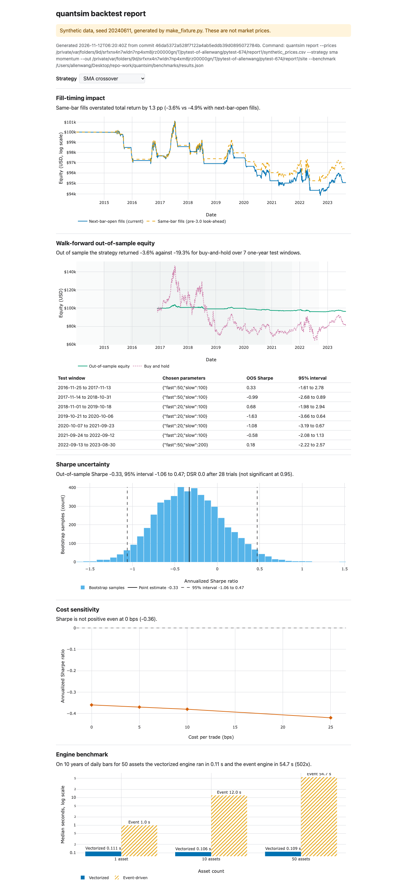

# quantsim

Event-driven and vectorized daily-bar backtesting in Python, with walk-forward testing and a deflated Sharpe check.



Live report: <https://allenwang0.github.io/quantsim/>. The Report workflow rebuilds it from seeded synthetic data on every push to `main`.

## Why

A daily backtest that trades at a price it could not have known, or that ignores costs, reports an edge that does not exist. Version 3.0.0 fixes fills at the signal bar's own open, positions resized every bar, a two-bar signal delay, a deflated Sharpe ratio on the wrong scale and analytics computed on monthly snapshots; each fix has a test that fails on the old code. See [CHANGELOG.md](CHANGELOG.md).

## How it works

```
event-driven engine (BacktestEngine)
  session T:   BarEvent -> Strategy (sees bars through T) -> SignalEvent
               -> PortfolioManager -> OrderEvent, held by the execution handler
  session T+1: order fills at T+1's open (plus slippage and commission)
               -> FillEvent -> Portfolio

vectorized engine (VectorizedBacktester)
  signal function -> position wanted at T's close, using data through T
  Numba simulation -> trades that position at T+1's price
```

- Fill timing: `FillModel.NEXT_BAR_OPEN` is the default. `IMMEDIATE_CLOSE` fills at bar T's close as an explicit opt-in. `SAME_BAR_OPEN_LOOKAHEAD` reproduces the pre-3.0 bug and exists only for the report's comparison.
- The vectorized simulator sizes a position from equity when its direction changes and holds it until the signal changes. It never trades an asset on a forward-filled price; `calendar="NYSE"` aligns rows to exchange sessions.
- The two engines are separate implementations: `Strategy` classes in the event engine, pandas signal functions in the vectorized one. `tests/test_engine_parity.py` runs an SMA crossover through both on one synthetic series and checks that round-trip counts match and total returns agree within 0.5 percentage points.
- Walk-forward (`WalkForwardOptimizer`) picks parameters on a training window and scores only the following test window. The test run starts at the training start so indicators are warm.
- The deflated Sharpe ratio (Bailey and Lopez de Prado, 2014) is the probability that the true Sharpe beats the best Sharpe expected from that many unskilled trials. quantsim treats DSR > 0.95 as significant.

## Quickstart

Needs [uv](https://docs.astral.sh/uv/) and Python 3.11 or 3.12.

```bash
git clone https://github.com/allenwang0/quantsim.git
cd quantsim
make setup
uv run python tests/fixtures/make_fixture.py
uv run quantsim report --prices tests/fixtures/synthetic_prices.csv --strategy sma momentum --out reports/demo
```

`make_fixture.py` writes 10 years of seeded synthetic prices for five assets. `quantsim report` runs the walk-forward optimizer, the bootstrap Sharpe interval and DSR, a cost sweep and the event engine twice (next-bar-open fills and the old same-bar fills), then writes `reports/demo/results.json` and `reports/demo/index.html`. Open the HTML file in a browser; it loads Plotly from jsDelivr.

### Verify your install

```bash
uv run pytest -m "not live and not browser"
```

`make browsers` installs Chromium for the Playwright test of the report page; after that, `make test` runs every offline test.

## Usage

Real prices come from yfinance (an unofficial source) and stay in a local SQLite database (default `~/.quantsim/quantsim.db`, or `--db`).

```bash
uv run quantsim bootstrap --symbols SPY --start 2015-01-01

# Event-driven backtest
uv run quantsim backtest --strategy sma --symbol SPY --start 2015-01-01

# Parameter sweep (vectorized), ranked by deflated Sharpe
uv run quantsim backtest --mode sweep --strategy sma --symbol SPY --start 2015-01-01

# Walk-forward optimization
uv run quantsim wfo --signal sma --symbol SPY --start 2015-01-01

# Report on real prices
uv run quantsim report --symbol SPY --start 2015-01-01 --strategy sma
```

`quantsim <command> --help` lists every option.

### Paper trading

```bash
uv run quantsim paper --strategy sma --symbol SPY
```

Without `ALPACA_API_KEY` and `ALPACA_SECRET_KEY` it simulates fills locally. With them, orders go to the Alpaca paper account. Live trading needs both `ALPACA_PAPER=false` and `QUANTSIM_ALLOW_LIVE=1`; any other `ALPACA_PAPER` value raises an error instead of trading. The Streamlit monitor runs in a second terminal: `uv run streamlit run src/quantsim/dashboard/app.py`.

## Results

Engine benchmark, from `benchmarks/results.json` (`make bench`):

| Assets | Vectorized (s) | Event-driven (s) | Event / vectorized |
|---:|---:|---:|---:|
| 1 | 0.1107 | 0.98 | 9x |
| 10 | 0.1059 | 11.96 | 113x |
| 50 | 0.1090 | 54.73 | 502x |

Median of 5 runs after a warm-up. Synthetic GBM with regime shifts, seed 7, 2520 daily bars (10 years); SMA crossover 50/200. The vectorized time includes its analytics; the event time is the `run()` loop. CPU: Apple M5 Pro; Python 3.12.13, NumPy 2.5.4, Numba 0.68.1.

Walk-forward result from the quickstart command. Data: synthetic GBM with regime shifts, seed 20240611, asset SYN0, 2014-01-02 to 2023-08-30. Costs: 0 bps in the walk-forward, 0 to 25 bps in the cost sweep.

| Strategy | Trials | Out-of-sample return | Buy and hold | OOS Sharpe (95% interval) | DSR |
|---|---:|---:|---:|---:|---:|
| SMA crossover | 28 | -3.6% | -19.3% | -0.33 (-1.06 to 0.47) | 0.0 |
| Time-series momentum | 14 | -3.9% | -19.3% | -0.36 (-0.97 to 0.34) | 0.0 |

Seven one-year test windows, 2016-11-25 to 2023-08-30. On random-walk data neither strategy has an edge, and the DSR says so.

## Related

- [statarb](https://github.com/allenwang0/statarb): standalone Kalman-filter pairs trading. quantsim's `PairsTradingStrategy` passes the same Kalman test cases (`tests/test_kalman.py`).
- [volatilityscanner](https://github.com/allenwang0/volatilityscanner): option pricing and implied volatility.

## Limitations

- Daily bars only.
- The default universe in `quantsim bootstrap` is today's large caps, so long backtests on it carry survivorship bias.
- No options backtesting. The 2.x options strategies only traded the underlying and were removed.
- yfinance is an unofficial data source; check its prices before trusting a result.
- Cash earns nothing while Sharpe subtracts a 5% risk-free rate by default, so a mostly-cash strategy shows a negative Sharpe.

## License

MIT. See [LICENSE](LICENSE).
